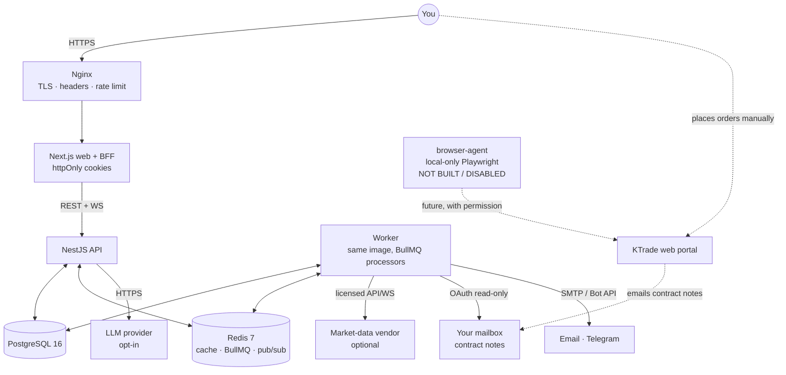

# 02 — System Architecture (Phase 2, complete)

_Status: Phase 2 deliverable, awaiting approval before Phase 3. Updated 2026-11-13._

**Objective:** a personal smart-trading platform for one KTrade account. It automates everything that can be legally and technically automated today: analysis, strategies, signals, paper trading, portfolio sync from broker-confirmed sources, monitoring and alerts. It keeps **live order submission** behind a capability chain that unlocks only with KTrade's written authorization.

| Doc | Content |
|---|---|
| [01](01-ktrade-feasibility-report.md) | KTrade / PSX integration feasibility |
| [03](03-browser-automation-investigation.md) | Browser-automation investigation & disabled adapter design |
| [04](04-security-and-credential-management.md) | Security & credentials |
| [05](05-database-design.md) | Database design + ERD (schema: [`apps/api/prisma/schema.prisma`](../apps/api/prisma/schema.prisma)) |
| [06](06-accounting-methodology.md) | Accounting methodology |
| [07](07-api-specification.md) | API specification |
| [08](08-strategy-and-trading-engine.md) | Strategy, signal & trading engine |
| [09](09-sync-and-market-data.md) | Portfolio sync, market data, sample data |

## 1. What is automated, and what is gated

| Area | Automation level today | Unlock condition for more |
|---|---|---|
| Market data, charts, movers | Automatic. SIMULATED until a licensed vendor key is added; then live or delayed | You subscribe to a vendor (e.g. Capital Stake) |
| Technical analysis & signals | **Fully automatic**: scheduled evaluation, scoring, explanations | — |
| Strategies (7 built-ins + custom rule builder) | **Fully automatic** in backtest and paper modes | — |
| Paper trading | **Fully automatic**: auto-execution of strategy signals | — |
| Alerts & notifications (in-app, email, Telegram) | **Fully automatic** | — |
| Portfolio sync | **Automatic** through contract-note emails (read-only mailbox OAuth); statements by upload | — |
| Analytics, reports, dividends | Automatic from the ledger | — |
| AI assistant | Automatic analysis (read-only) | — |
| Live order *preparation & validation* | **Automatic**: signals become pre-filled, risk-checked orders | — |
| Live order *submission* | **Manual**: you approve, then place the order in the KTrade app | KTrade written permission → browser adapter (submit-by-you), then optionally pre-authorized auto-execution |
| Broker-side reads (cash, order book) | Next-day, from contract notes and statements | KTrade written permission → browser adapter read-only |

## 2. System context



## 3. Repository layout (pnpm + Turborepo)

```
stock-project/
├── apps/
│   ├── api/                 NestJS (REST, WS, Swagger) + Prisma
│   │   ├── prisma/          schema.prisma ✅, migrations/, seed/
│   │   └── src/modules/     (see §4)
│   ├── worker/              BullMQ processors (imports shared modules from api via packages)
│   ├── web/                 Next.js App Router, Tailwind, shadcn/ui, lightweight-charts, Recharts
│   └── browser-agent/       ⛔ placeholder README only, until authorized (doc 03)
├── packages/
│   ├── finance-core/        decimal maths: fees, WAC/FIFO, P&L, TWR/XIRR, indicators, rule DSL, risk checks, fill models
│   ├── broker-sdk/          BrokerAdapter + MarketDataProvider interfaces, capability types, contract-test suite
│   ├── parsers/             statement / contract-note parsers + golden-file tests
│   ├── shared/              Zod schemas, DTOs, enums, API client types
│   └── config/              eslint, tsconfig, prettier presets
├── infra/                   docker-compose.yml, nginx/, postgres/ (roles, init), scripts/
├── docs/
└── .github/workflows/       lint · typecheck · test · build · prisma validate/diff · gitleaks · openapi-sync
```

Dependency rule: `finance-core` and `broker-sdk` depend on nothing app-specific. Apps depend on packages, never the other way round. This is enforced with `eslint-plugin-boundaries`.

## 4. Backend modules

| Module | Responsibility | Doc |
|---|---|---|
| `auth`, `users`, `rbac` | Argon2id, JWT + rotating refresh, TOTP, step-up, sessions | 04 |
| `audit` | Append-only audit trail (interceptor + domain events) | 04 |
| `vault` | Envelope encryption of third-party secrets | 04 |
| `broker` | Adapter registry, capability chain guard, connections | §5 |
| `sync` | Imports, parser registry, mailbox poller, reconciliation, discrepancy checks | 09 |
| `ledger` | Transactions, fees, cash, holdings and lot projections, replay | 06 |
| `portfolio` | Valuation, snapshots, dashboard aggregates | 06 |
| `corporate-actions`, `dividends` | Bonus, split, rights, entitlements, WHT | 06 |
| `market-data` | Provider registry, quotes, bars, movers, watchlists, freshness | 09 |
| `strategies` | Templates, DSL, evaluation scheduler, signals, scoring | 08 |
| `backtesting` | Event-driven simulator, metrics, benchmark | 08 |
| `trading` | Order intents, preview, risk engine, approval policies, execution router, kill switch | 08 |
| `paper` | `PaperBrokerAdapter`, fill models | 08 |
| `alerts`, `notifications` | Rule evaluation, channels, dedupe, quiet hours | 07 |
| `analytics`, `reports` | Period performance, PDF/CSV/XLSX | 07 |
| `assistant` | LLM provider abstraction, read-only tools, citations | 07 |
| `settings`, `health` | Fees/taxes/risk configuration, readiness | — |

## 5. Extensibility: broker adapters

```ts
// packages/broker-sdk
export type Capability =
  | 'readAccount' | 'readCash' | 'readHoldings' | 'readOrders' | 'readExecutions'
  | 'prepareOrder' | 'placeOrder' | 'cancelOrder' | 'streamOrderUpdates';

export interface CapabilityState {
  implemented: boolean;   // code exists and passes the adapter contract tests
  verified: boolean;      // checked in a supervised session against the real platform
  authorized: boolean;    // broker's written permission on record
  authorizationRef?: string;
  enabled: boolean;       // you switched it on (TOTP, audited)
}

export interface BrokerAdapter {
  readonly kind: BrokerAdapterKind;
  capabilities(): Record<Capability, CapabilityState>;
  getCash?(ctx): Promise<Sourced<CashBalance>>;
  getHoldings?(ctx): Promise<Sourced<HoldingDto[]>>;
  getOrders?(ctx, q): Promise<Sourced<BrokerOrderDto[]>>;
  getExecutions?(ctx, q): Promise<Sourced<ExecutionDto[]>>;
  prepareOrder?(ctx, o: ApprovedOrder): Promise<PreparedOrderResult>;    // fills a form; does not submit
  placeOrder?(ctx, o: ApprovedOrder): Promise<SubmissionReceipt>;        // never returns "filled"
  cancelOrder?(ctx, brokerOrderRef: string): Promise<CancelReceipt>;
  getOrderStatus?(ctx, brokerOrderRef: string): Promise<Sourced<BrokerOrderStatus>>;
}
```

- `BrokerCapabilityGuard` allows a call only if all four flags are true. Otherwise it throws `CAPABILITY_UNAVAILABLE`, and the UI hides or greys out the action with the reason.
- Every adapter must pass `broker-sdk`'s **contract-test suite**: idempotent place, no fill on submit, status mapping, error mapping, and a refusal when the capability is off.
- Current adapters:
  - `ManualImport` (read via `sync`)
  - `Paper` (full)
  - `KTradeOfficial` (stub; all capabilities `implemented=false`)
  - `KTradeBrowser` (stub; all capabilities `implemented=false`; design in doc 03)
- **Adding a broker or API later** means implementing `BrokerAdapter` and registering it. No changes to trading, risk, ledger or UI.
- **Path to automatic live execution** (no code redesign needed): adapter implemented → verified → KTrade authorizes → you enable `placeOrder` → `RiskLimit.liveAutoExecutionEnabled` (TOTP) → per-strategy `autoExecute`. The `PreAuthorizedLivePolicy` is already part of the design (doc 08 §7) and stays unreachable until then.

## 6. Data provenance (shown everywhere in the UI)

| Badge | Meaning |
|---|---|
| ✅ Confirmed | Contract note or broker/CDC statement |
| 👁 Broker-displayed | Read from the broker UI or API, not yet matched to a statement |
| 📡 Market data | Licensed provider (with delay shown) |
| ✍ Manual | Entered by you |
| ≈ Estimated | From fee/tax tables or reference prices |
| 🧪 Simulated | Paper, backtest, demo or sample data |

Aggregates show a breakdown (for example "82% confirmed / 18% estimated"). Simulated values are never mixed into LIVE totals.

## 7. Frontend

Next.js App Router with route groups `(auth)` and `(app)`. The BFF route handlers proxy to the API and hold tokens in httpOnly cookies. Data fetching uses TanStack Query with WebSocket-driven cache updates; forms use react-hook-form with the shared Zod schemas; tables use TanStack Table with server pagination, filters and search. Charts: lightweight-charts for price and equity curves with indicator overlays, and Recharts for allocation, bars and P&L. The layout is responsive, with a sidebar on desktop, a collapsible rail on tablet and a bottom nav on mobile. Global banners show the data mode (SIMULATED / delayed / live), the kill-switch state, and "Live execution is manual".

**Pages (19):**
1. Login / Register
2. Dashboard
3. Portfolio
4. Holdings
5. Buy/Sell (order ticket + preview)
6. Orders
7. Transactions
8. Market Watch
9. Stock Details
10. Strategies (template gallery, rule builder, signals)
11. Backtesting
12. Paper Trading
13. Dividends
14. Analytics & Reports
15. Notifications
16. AI Assistant
17. KTrade Integration (connections, capability manifest, imports, mailbox sync, discrepancies)
18. Security
19. Settings (fees/taxes, risk limits, providers, channels)

## 8. Infrastructure

- `docker-compose`: postgres:16, redis:7, a one-shot `migrate`, `api`, `worker`, `web`, `nginx`.
- Prisma migrations, plus a raw-SQL migration for CHECK constraints and the append-only grants.
- Config via `@nestjs/config` with Zod; the app fails fast on missing secrets.
- pino JSON logs with redaction, request ids, `/health` and `/ready`.
- All ports bind to 127.0.0.1 in development.
- CI: lint, typecheck, unit, integration (Testcontainers), build, `prisma validate`, migration drift check, gitleaks, OpenAPI-sync test.

## 9. Testing strategy

| Layer | Tooling | Focus |
|---|---|---|
| finance-core | Vitest + fast-check | Fee rules, WAC/FIFO fixtures (doc 06), replay == incremental, indicators vs reference values, rule DSL, risk checks, fill models |
| parsers | Golden files (redacted real samples) | Every field of every sample |
| API | Jest + Supertest + Testcontainers (PG, Redis) | Auth and refresh reuse, RBAC, idempotent order replay, risk limits, kill switch, preview-hash mismatch, import dedupe, reconciliation |
| broker-sdk | Contract suite | Paper + mock adapters; KTrade stubs **must refuse** |
| Strategy engine | Deterministic bar fixtures | No look-ahead, exit priority, cooldown, signal dedupe across retries |
| Web | Vitest + Testing Library; Playwright smoke | Login → dashboard → paper order → fill |

No test touches a live broker or real funds. CI has no broker credentials.

## 10. Phase plan

| Phase | Deliverable | Status |
|---|---|---|
| 1 | Feasibility + browser-automation investigation | ✅ Done |
| 2 | Architecture, schema (validated and applied on PG16), ERD, accounting, API spec, engine design, sync and market-data design | ✅ **Done (this doc set). Awaiting your approval** |
| 3 | Monorepo, scaffolds, Docker, CI, finance-core skeleton | Next |
| 4 | Auth, RBAC, audit, vault, migrations (+ raw SQL), seed | |
| 5 | broker-sdk + adapters (Paper, stubs), sync pipeline, generic CSV parser; KTrade parsers once samples arrive; mailbox OAuth | Contract-note parser needs samples |
| 6 | Ledger, fees, WAC/FIFO, corporate actions, portfolio and dashboard | |
| 7 | Market data: Simulated + CSV providers, quotes WS, charts, movers, watchlists; Capital Stake adapter scaffold | Live data needs a vendor key |
| 8 | Trading: preview, risk engine, approval, manual-ticket flow, kill switch | |
| 9 | Indicators, rule DSL, strategies, signals, backtester, paper trading | |
| 10 | Alerts, notifications, dividends, analytics, exports | |
| 11 | AI assistant | Needs an LLM API key |
| 12 | Hardening, full test pass, deployment and security docs | |

## 11. Inputs still needed from you (none block Phase 3)

1. Redacted **contract note**, **ledger statement** and **holdings/CDC statement** samples (for Phase 5 parsers).
2. The sender address and subject format of KTrade's contract-note emails, and which mailbox provider you use (Gmail or Outlook).
3. KTrade's reply to the permission request (doc 03 §6).
4. A market-data vendor decision (can wait; SIMULATED until then).
5. Your tax filer (ATL) status, and confirmation of current CGT and dividend WHT rates (can wait; placeholders until then).
