# 05 — Database Design

Source of truth: [`apps/api/prisma/schema.prisma`](../apps/api/prisma/schema.prisma).
**Verified 2026-11-13:** `prisma validate` passes (Prisma 6.16.2). The generated DDL (46 tables, 1,370 lines) applies cleanly to PostgreSQL 16.

## 1. Conventions

| Topic       | Rule                                                                                                                                     |
| ----------- | ---------------------------------------------------------------------------------------------------------------------------------------- |
| Keys        | UUID v4 (`gen_random_uuid()`); `BIGSERIAL` for high-volume append-only tables (`stock_prices`, `order_events`, `audit_logs`)             |
| Money       | `NUMERIC(20,4)`. Prices and per-share values `NUMERIC(20,6)`. Rates `NUMERIC(12,8)`. Quantities `NUMERIC(20,4)`                          |
| In code     | Prisma `Decimal` → `decimal.js`. **No JS `number` for money anywhere.** Values are serialized to the API as **strings**                  |
| Time        | `timestamptz` for instants. `date` for trading, settlement and book-closure dates (Asia/Karachi calendar)                                |
| Provenance  | Every financial fact has `source: DataSource` = `BROKER_CONFIRMED > BROKER_DISPLAYED > PROVIDER > USER_REPORTED > ESTIMATED > SIMULATED` |
| Corrections | Ledger rows are never edited in place. A correction is a **reversal** (`transactions.reversedById`) plus a new row                       |
| Naming      | snake_case plural table names (`@@map`); camelCase columns                                                                               |

## 2. Entity-relationship diagram

```mermaid
erDiagram
  users ||--o| user_settings : has
  users ||--o{ refresh_tokens : "sessions"
  users ||--o{ credential_vault : "encrypted secrets"
  users ||--o{ broker_accounts : owns
  users ||--o{ portfolios : owns
  users ||--o{ watchlists : ""
  users ||--o{ trading_strategies : ""
  users ||--o{ backtest_results : ""
  users ||--o{ alerts : ""
  users ||--o{ notifications : ""
  users ||--o{ notification_channel_configs : ""
  users ||--o{ ai_conversations : ""
  users ||--o{ audit_logs : actor

  broker_accounts ||--o{ broker_connections : "adapter per row"
  broker_accounts ||--o{ broker_balance_snapshots : ""
  broker_accounts ||--o{ imported_statements : ""
  broker_accounts ||--o{ portfolios : "LIVE portfolio"
  credential_vault ||--o{ broker_connections : ""

  portfolios ||--o{ holdings : ""
  portfolios ||--o{ holding_lots : ""
  portfolios ||--o{ transactions : ledger
  portfolios ||--o{ cash_movements : ledger
  portfolios ||--o{ portfolio_snapshots : "EOD valuation"
  portfolios ||--o{ orders : ""
  portfolios ||--o{ order_executions : ""
  portfolios ||--o{ dividend_entitlements : ""
  portfolios ||--o| risk_limits : ""
  portfolios ||--o{ trading_strategies : ""

  stocks ||--o{ stock_prices : OHLCV
  stocks ||--o| stock_quotes : latest
  stocks ||--o{ holdings : ""
  stocks ||--o{ transactions : ""
  stocks ||--o{ orders : ""
  stocks ||--o{ corporate_actions : ""
  stocks ||--o{ dividends : ""
  watchlists ||--o{ watchlist_stocks : ""
  stocks ||--o{ watchlist_stocks : ""

  orders ||--o{ order_events : "state log"
  orders ||--o{ order_risk_checks : ""
  orders ||--o{ order_executions : fills
  order_executions ||--o| transactions : "posts to"
  transactions ||--o{ transaction_fees : breakdown
  transactions ||--o{ holding_lots : opens
  transactions ||--o{ cash_movements : settles
  fee_schedules ||--o{ fee_schedule_items : ""
  fee_schedules ||--o{ transaction_fees : "estimated by"

  corporate_actions ||--o{ transactions : "bonus/split/rights"
  corporate_actions ||--o| dividends : ""
  dividends ||--o{ dividend_entitlements : ""
  dividend_entitlements ||--o| cash_movements : "paid as"

  imported_statements ||--o{ imported_rows : staging
  imported_statements ||--o{ transactions : sources
  imported_statements ||--o{ cash_movements : sources
  imported_statements ||--o{ order_executions : sources
  imported_statements ||--o{ broker_balance_snapshots : sources

  trading_strategies ||--o{ strategy_parameters : ""
  trading_strategies ||--o{ strategy_signals : ""
  trading_strategies ||--o{ strategy_executions : "eval runs"
  trading_strategies ||--o{ backtest_results : ""
  trading_strategies ||--o{ orders : ""
  strategy_signals ||--o| orders : "prepares"
  backtest_results ||--o{ backtest_trades : ""

  alerts ||--o{ notifications : triggers
  ai_conversations ||--o{ ai_messages : ""
```

Standalone tables: `tax_rates`, `system_settings`, `market_holidays`.

## 3. Table groups (46 tables)

| Group               | Tables                                                                                                            | Notes                                                                                  |
| ------------------- | ----------------------------------------------------------------------------------------------------------------- | -------------------------------------------------------------------------------------- |
| Identity & security | users, user_settings, refresh_tokens, credential_vault, audit_logs                                                | Only refresh-token hashes are stored; the vault uses AES-256-GCM envelope encryption   |
| Broker              | broker_accounts, broker_connections, broker_balance_snapshots                                                     | `broker_connections.capabilities` is the per-capability manifest that gates automation |
| Ledger              | portfolios, transactions, transaction_fees, cash_movements, holdings, holding_lots, portfolio_snapshots           | `holdings` and `holding_lots` are **projections**, rebuildable from `transactions`     |
| Fees, tax, risk     | fee_schedules, fee_schedule_items, tax_rates, risk_limits, system_settings                                        | Effective-dated. The kill switch lives in `system_settings`                            |
| Orders              | orders, order_events, order_risk_checks, order_executions                                                         | Executions can exist without an order (trades learned from contract notes)             |
| Market              | stocks, stock_prices, stock_quotes, market_holidays, watchlists, watchlist_stocks                                 | BRIN index on `stock_prices.ts`                                                        |
| Corporate actions   | corporate_actions, dividends, dividend_entitlements                                                               |                                                                                        |
| Sync                | imported_statements, imported_rows                                                                                | Staging → review → commit                                                              |
| Strategy            | trading_strategies, strategy_parameters, strategy_signals, strategy_executions, backtest_results, backtest_trades |                                                                                        |
| Alerts              | alerts, notifications, notification_channel_configs                                                               |                                                                                        |
| AI                  | ai_conversations, ai_messages                                                                                     | `toolCalls` records the data each answer was based on                                  |

The 22 tables you requested are all present. These additions were needed for correctness:

- `holding_lots`: FIFO and holding-period tax analysis
- `transaction_fees`: per-component fee provenance
- `corporate_actions`, `dividend_entitlements`: cost-basis adjustments and dividends actually received
- `portfolio_snapshots`: daily P&L and time-weighted return (TWR)
- `order_events`, `order_risk_checks`: an auditable order lifecycle
- `broker_balance_snapshots`: broker-reported cash
- `imported_rows`: reviewable imports
- `fee_schedules`, `fee_schedule_items`, `tax_rates`, `risk_limits`, `system_settings`
- `refresh_tokens`, `credential_vault`, `user_settings`, `market_holidays`
- `stock_quotes`, `backtest_trades`, `notification_channel_configs`, `ai_*`

## 4. Key constraints & idempotency

| Constraint                                                                                                                                        | Purpose                                                                                   |
| ------------------------------------------------------------------------------------------------------------------------------------------------- | ----------------------------------------------------------------------------------------- |
| `orders UNIQUE(userId, idempotencyKey)`                                                                                                           | Duplicate-submission protection                                                           |
| `orders UNIQUE(adapter, brokerOrderRef)`                                                                                                          | A broker order maps to exactly one internal order                                         |
| `imported_statements UNIQUE(brokerAccountId, fileSha256)` and `UNIQUE(brokerAccountId, emailMessageId)`                                           | The same file or email is never imported twice                                            |
| `imported_rows INDEX(fingerprint)`                                                                                                                | Cross-file dedupe (the same trade appearing in a contract note _and_ a monthly statement) |
| `transactions UNIQUE(portfolioId, externalRef, stockId, type)`                                                                                    | One posting per contract-note line                                                        |
| `order_executions UNIQUE(portfolioId, brokerExecRef)`                                                                                             | One fill per broker execution ref                                                         |
| `strategy_signals UNIQUE(strategyId, barTs, type, reason)`                                                                                        | A strategy can't fire the same signal twice for one bar, even across worker retries       |
| `notifications UNIQUE(userId, channel, dedupeKey)`                                                                                                | No duplicate alerts                                                                       |
| `holdings UNIQUE(portfolioId, stockId)`, `portfolio_snapshots UNIQUE(portfolioId, date)`, `dividend_entitlements UNIQUE(dividendId, portfolioId)` | Projection integrity                                                                      |

**Extra SQL added in the Phase 4 migration** (Prisma can't express these):

- `CHECK` constraints: `holdings.quantity >= 0`; `orders.quantity > 0`; `limitPrice IS NOT NULL` when `type IN ('LIMIT','STOP_LIMIT')`; `stock_prices.high >= low`; `portfolios.initialCash IS NULL` when `kind='LIVE'`.
- Partial unique index: one active strategy per `(portfolioId, stockId, type)` when `isActive`.
- `REVOKE UPDATE, DELETE ON audit_logs, order_events FROM app_user`, which makes both append-only.
- A separate `app_migrator` role owns the DDL. The runtime `app_user` has DML only.

## 5. Transaction boundaries

| Operation                | Single DB transaction (SERIALIZABLE or row locks)                                                                                                    |
| ------------------------ | ---------------------------------------------------------------------------------------------------------------------------------------------------- |
| Post a fill              | insert execution → transaction + fees → cash movement → update holding (`SELECT … FOR UPDATE`) → lots → order filledQty/status → order_event → audit |
| Commit an import         | all accepted rows of one statement, or none                                                                                                          |
| Approve an order         | re-run risk checks under a lock on the portfolio's `risk_limits` row (serializes daily-limit counting) → status → event → audit                      |
| Apply a corporate action | every affected holding in one transaction                                                                                                            |

## 6. Retention

- `stock_prices`: indefinite for D1 bars, 2 years for intraday (pruning job).
- `audit_logs`, `order_events`: indefinite.
- Raw import files: 90 days, after which `storagePath` is nulled while the parsed rows are kept.
- `notifications`: 180 days.
