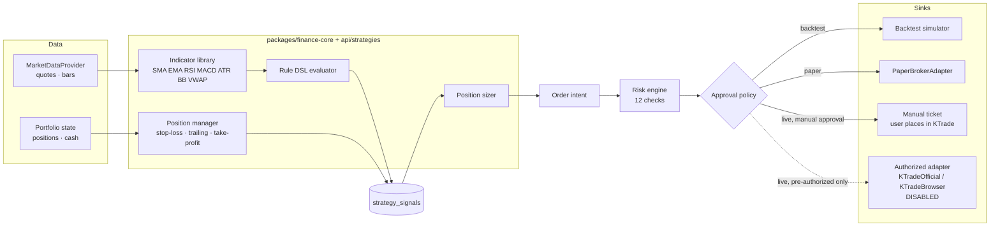

# 08 — Strategy, Signal & Trading Engine

Goal: one engine that runs the **same strategy code** in backtest, paper and live modes. Only the _clock_, the _data feed_ and the _execution sink_ differ between modes. That way a strategy behaves identically in all three, and moving from backtest to paper to live changes configuration, not code.

## 1. Component overview



## 2. Indicators (`finance-core/indicators`)

Pure, incremental, decimal-based functions with streaming state, so live evaluation doesn't recompute the full history:

- SMA, EMA, WMA
- RSI (Wilder)
- MACD (line, signal, histogram)
- ATR, Bollinger Bands, ROC
- rolling high/low, volume SMA
- VWAP (intraday only, and only when intraday data exists)

Each indicator declares a `warmupBars` count. No signal is produced until warmup is complete. Tests check each indicator against reference values computed independently and committed as fixtures.

## 3. Rule DSL (stored in `trading_strategies.entryRules / exitRules`)

```jsonc
{
  "all": [
    // all | any | not
    {
      "crossesAbove": [
        { "ind": "EMA", "period": "$fastPeriod" },
        { "ind": "EMA", "period": "$slowPeriod" },
      ],
    },
    { "gt": [{ "ind": "RSI", "period": 14 }, { "const": "50" }] },
    { "gt": [{ "field": "volume" }, { "mul": [{ "ind": "VOLUME_SMA", "period": 20 }, { "const": "1.5" }] }] },
  ],
}
```

- **Operands:**
  - `ind` (indicator with params)
  - `field` (open/high/low/close/volume/changePct)
  - `position.*` (qty, avgCost, unrealizedPct, barsHeld, highSinceEntry)
  - `const`, `$param` (from `strategy_parameters`)
  - arithmetic `add/sub/mul/div`
- **Operators:** `gt gte lt lte eq crossesAbove crossesBelow between`, `rising(n)`, `falling(n)`.
- The DSL is validated by a Zod schema and compiled to a closure once per strategy version. Arbitrary code execution is impossible because the DSL is data, never `eval`.
- **Explainability:** every evaluation returns a trace (each condition, its operand values, true or false). The trace is stored in `strategy_signals.indicators` and shown in the UI ("EMA(9)=251.20 crossed above EMA(21)=250.85; RSI(14)=57.3 > 50 ✔").

### Built-in templates (compile to the DSL, parameters editable)

| Template        | Entry                                           | Exit                                 | Default params            |
| --------------- | ----------------------------------------------- | ------------------------------------ | ------------------------- |
| MA Crossover    | fast EMA crosses above slow                     | fast crosses below slow              | fast 9, slow 21, type EMA |
| RSI             | RSI crosses above `oversold`                    | RSI crosses below `overbought`       | 14, 30, 70                |
| MACD            | MACD crosses above signal (optionally hist > 0) | MACD crosses below signal            | 12, 26, 9                 |
| Stop-loss %     | —                                               | `close ≤ avgCost × (1 − sl%)`        | 5%                        |
| Take-profit %   | —                                               | `close ≥ avgCost × (1 + tp%)`        | 10%                       |
| Trailing stop % | —                                               | `close ≤ highSinceEntry × (1 − ts%)` | 7%                        |
| Price alert     | `close ≥ / ≤ target` (signal or alert only)     | `close ≥ / ≤ exit target`            | —                         |
| Custom rules    | user-built in the UI rule builder               | user-built                           | —                         |

Stop-loss, take-profit and trailing-stop can also be **overlays** on any entry strategy, through the `stopLossPct`, `takeProfitPct` and `trailingStopPct` columns.

**Exit priority within one bar:** stop-loss → trailing stop → take-profit → rule exit. Only one exit fires.

## 4. Position sizing & strategy-level risk

`suggestedQty = min(`

- `floor(maxInvestment_remaining / (price × (1 + feeEstimatePct)))`,
- `maxPositionQty`,
- `riskPerTradePct × equity / (price − stopPrice)` (when a stop is defined),
- the portfolio's concentration cap

`)`, rounded down to whole shares, and `0` means no signal is emitted. Strategies are long-only in v1, because PSX retail short-selling is not modelled. A cooldown of `cooldownBars` applies after an exit.

## 5. Execution modes

|                | Backtest                                                                                                                                        | Paper                                                                                                                                   | Live                                                                                       |
| -------------- | ----------------------------------------------------------------------------------------------------------------------------------------------- | --------------------------------------------------------------------------------------------------------------------------------------- | ------------------------------------------------------------------------------------------ |
| Clock          | historical bars, event loop                                                                                                                     | scheduler (BullMQ repeatable job at bar close, PSX market hours, holidays skipped)                                                      | same as paper                                                                              |
| Data           | `stock_prices` (any source; result labelled with the weakest provenance)                                                                        | active `MarketDataProvider`                                                                                                             | active provider. Requires `PROVIDER`-grade data; **SIMULATED prices are refused for live** |
| Fill model     | signal at close of bar _t_ → fill at **open of t+1** (no look-ahead) ± slippage bps; limit orders fill only if the bar trades through the limit | next quote after the order ± slippage; limit fills when last crosses the limit; partial fills optional via volume cap (% of bar volume) | broker                                                                                     |
| Fees           | fee engine (same as ledger)                                                                                                                     | fee engine                                                                                                                              | contract note (estimates until then)                                                       |
| Signal → order | automatic                                                                                                                                       | automatic **if `autoExecute`**, otherwise a prepared order waits for a click                                                            | **prepared order, manual approval** (§7)                                                   |
| Provenance     | SIMULATED                                                                                                                                       | SIMULATED                                                                                                                               | BROKER_CONFIRMED after reconciliation                                                      |

**Backtest metrics:**

- total return, CAGR, max drawdown, Sharpe (daily, rf configurable)
- win rate, profit factor, average win/loss, exposure %, fees paid
- **buy-and-hold benchmark** on the same symbol and period

Every backtest result page and API response shows: _"Past simulated performance does not guarantee future returns. Results exclude market impact and may use simulated or delayed data."_ Walk-forward and out-of-sample splits are supported, to reduce overfitting.

## 6. Paper trading

- Any number of `PAPER` portfolios, each with its own `initialCash`, risk limits and strategies.
- The `PaperBrokerAdapter` implements the **same `BrokerAdapter` interface** as live adapters, with the same order state machine, `order_events` and risk checks. Paper trading therefore exercises the real workflow end to end.
- Manual paper orders come from the Buy/Sell page; strategy orders come from signals.
- "Mirror" mode (optional): your live strategies also run in shadow paper mode, so you can compare what they _would_ have done with what you actually did.

## 7. Order pipeline & approval policy

```
Signal / manual ticket / alert action / AI suggestion
        │
        ▼
OrderIntent ──► Preview (price ref, fee estimate, preview hash, 5-min expiry, idempotency key)
        │
        ▼
Risk engine (all must pass; each result stored in order_risk_checks)
  1 KILL_SWITCH        global trading.live.enabled (LIVE only)
  2 CAPABILITY         adapter capability chain implemented∧verified∧authorized∧enabled
  3 MARKET_HOURS       PSX session & holiday calendar
  4 BUYING_POWER       cash − pending buys ≥ estTotal
  5 HOLDING_QTY        held − pending sells ≥ qty
  6 MAX_ORDER_VALUE / 7 MAX_ORDER_QTY
  8 PRICE_BAND         |limit − last| / last ≤ priceBandPct
  9 DAILY_VALUE / 10 DAILY_COUNT   (counted under row lock)
 11 CONCENTRATION      post-trade position weight ≤ maxPositionPct
 12 DAILY_LOSS         if portfolio down > maxDailyLossPct today → block BUYs
        │
        ▼
ApprovalPolicy.decide(order) ──►
  • ManualApprovalPolicy (DEFAULT, LIVE): user reviews the preview → step-up auth (TOTP) → APPROVED
  • PaperAutoPolicy (PAPER + strategy.autoExecute): auto-approve
  • PreAuthorizedLivePolicy (FUTURE, OFF): only selectable when ALL of:
       – adapter.placeOrder capability: implemented ∧ verified ∧ authorized (KTrade written ref) ∧ enabled
       – global kill switch ON
       – RiskLimit.liveAutoExecutionEnabled = true (set with TOTP, audited)
       – strategy.autoExecute = true and strategy.mode = LIVE
       – order origin ≠ AI_SUGGESTION
     AI suggestions always require manual approval, whatever the settings.
        │
        ▼
ExecutionRouter
  • adapter can placeOrder → SUBMITTED → poll/stream status → fills
  • adapter cannot          → AWAITING_MANUAL_PLACEMENT (ticket shown) → user marks PLACED_BY_USER
                              → user records the fill (USER_REPORTED) → contract note reconciles (BROKER_CONFIRMED)
```

**Rules:**

- Approval binds to the **preview hash**. Any change to symbol, side, qty, price or type invalidates it.
- A click or HTTP 200 from an adapter is never treated as a fill. Status only advances on an adapter status read (`BROKER_DISPLAYED`) or a contract note (`BROKER_CONFIRMED`). Ambiguous outcomes become `UNKNOWN`, block further orders on that symbol, and alert you.
- Live orders are **never retried automatically**.
- Cancellation follows the same pattern (`CANCEL_REQUESTED` → confirmed `CANCELLED`).

## 8. Scheduling (BullMQ queues)

| Queue                          | Trigger                                            | Job                                                 |
| ------------------------------ | -------------------------------------------------- | --------------------------------------------------- |
| `market.quotes`                | every N s during market hours (provider-dependent) | refresh quotes → Redis + `stock_quotes` → WebSocket |
| `market.bars`                  | bar close per interval; EOD at 16:00 PKT           | upsert `stock_prices`                               |
| `strategy.evaluate`            | after `market.bars` for that interval              | evaluate active strategies → signals                |
| `orders.lifecycle`             | signal created, preview expiry, adapter polling    | prepare / expire / status sync                      |
| `paper.fills`                  | quote updates                                      | match working paper orders                          |
| `alerts.evaluate`              | quote update, portfolio revaluation, order events  | fire alerts → notifications                         |
| `portfolio.snapshot`           | EOD                                                | write `portfolio_snapshots`                         |
| `sync.mailbox`, `sync.imports` | every 15 min / on upload                           | contract-note ingestion → reconcile                 |
| `backtest.run`                 | on request                                         | run, persist results                                |

Jobs are idempotent: job ids are derived from `(strategyId, barTs)` and similar, and are backed by DB unique constraints.

## 9. "Intelligent" signal enhancements (all explainable, no black boxes)

- **Signal scoring:** a 0–100 confidence score built from agreement of trend (MA), momentum (RSI/MACD), volume confirmation and volatility regime (ATR percentile). Each component is shown.
- **Multi-timeframe confirmation:** entry on D1 only if the weekly trend is aligned (optional).
- **Market regime filter:** suppress entries when the KSE-100 is below its 200-day MA (optional; requires index data from the provider).
- **AI commentary** (Phase 11) can _explain_ a signal from the trace but cannot create or approve orders.
