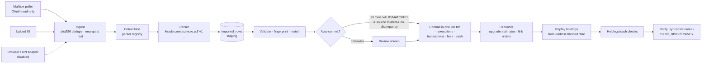

# 09 — Portfolio Synchronization & Market Data

## Part A — Automatic portfolio synchronization

### A1. Authorized sources, ranked by how automatic they are

| # | Source | Automation level | Provenance | Status |
|---|---|---|---|---|
| 1 | **Contract-note emails** in your mailbox (KTrade must send them by the next trading day, per T&C §5(e)) | **Fully automatic.** The app reads *your* mailbox through OAuth with a read-only scope, filtered to KTrade's sender address and the subject pattern | BROKER_CONFIRMED | Build in Phase 5. Needs a sample contract note |
| 2 | Contract note PDF / `.eml` upload | One drag-and-drop | BROKER_CONFIRMED | Phase 5 |
| 3 | Ledger / holdings statement (CSV, XLSX, PDF) | Upload; mailbox if KTrade emails them | BROKER_CONFIRMED | Phase 5. Needs samples |
| 4 | CDC statement (holdings custody record) | Upload | BROKER_CONFIRMED (custodian) | Phase 5. Needs a sample |
| 5 | Manual entry / "I placed this order" | Click | USER_REPORTED | Phase 6 |
| 6 | `KTradeBrowserAdapter` read-only sync | Scheduled, with you logging in | BROKER_DISPLAYED | **Disabled until KTrade gives written permission** |
| 7 | `KTradeOfficialAdapter` (API) | Fully automatic | BROKER_CONFIRMED | **Disabled until an API exists** |

### A2. Pipeline



- **Parser registry:** each parser declares `kind`, `detect(file) → confidence`, `parse(file) → rows`, and a version. Parsers run in a sandboxed worker with a timeout. PDF parsing extracts text only and never executes content.
- **Auto-commit** is on for contract notes once the parser has been checked against your real samples (golden-file tests). Statements always need review the first time.
- **Fingerprint:** `sha256(accountId|tradeDate|symbol|side|qty|price|contractRef?)`. This stops the same trade being posted twice when it appears in both a contract note and a monthly statement.
- **Mailbox security:** only the read-only scope is requested; the refresh token is stored in the vault; messages are fetched by query `from:<ktrade sender> has:attachment`; and nothing else in the mailbox is read or stored. Disconnecting revokes the grant.

### A3. What "real-time" means for your account today
- Trades you place in the KTrade app appear in the platform **when the contract-note email arrives**, usually the same evening or the next morning. They appear immediately if you also click "I placed this order" from the prepared ticket.
- Intraday values of your positions are live, based on market data (Part B).

## Part B — Market data

### B1. Provider abstraction

```ts
interface MarketDataProvider {
  key: string;                          // "simulated", "csv-eod", "capitalstake", …
  capabilities: { quotes: boolean; intradayBars: boolean; eodBars: boolean;
                  corporateActions: boolean; streaming: boolean; delayMinutes: number };
  source: DataSource;                   // PROVIDER | USER_REPORTED | SIMULATED
  getQuotes(symbols: string[]): Promise<Quote[]>;
  getBars(symbol: string, interval: PriceInterval, from: Date, to: Date): Promise<Bar[]>;
  getCorporateActions?(symbol: string, from: Date, to: Date): Promise<CorporateActionDto[]>;
  subscribe?(symbols: string[], onTick: (q: Quote) => void): Unsubscribe;
  healthCheck(): Promise<ProviderHealth>;
}
```

| Provider | Data | Label | Status |
|---|---|---|---|
| `SimulatedProvider` | Synthetic OHLCV (seeded geometric Brownian motion, with plausible PSX tick sizes and volume) and a simulated live tick stream | **SIMULATED**, with a banner in the UI | **Built in Phase 7.** Default for development and demo |
| `CsvEodProvider` | Imports EOD/historical CSVs that **you** hold a licence or right to use | USER_REPORTED (or PROVIDER if the file comes from a licensed vendor export) | Phase 7 |
| `CapitalStakeProvider` | Quotes, 1/5/15-min bars, EOD (adjusted), corporate actions, WebSocket streaming (per their public docs) | PROVIDER | **Adapter scaffolded but disabled.** It needs a subscription, an API key, and their full API docs to finish the request mapping. Not built against guessed endpoints |
| PSX EOD subscription (PSX × Deutsche Börse) | EOD | PROVIDER | Same condition |

**I cannot sign up for a data vendor on your behalf.** Real-time or delayed live PSX prices start the day you supply a licensed vendor's API key through Settings → Integrations. Until then, the platform runs end to end on SIMULATED prices, and every screen says so.

### B2. Rules
- Scraping PSX or broker websites is excluded.
- One active provider per data type (quotes / bars / corporate actions); a fallback order is configurable.
- Each quote carries `asOf`, `delayMinutes`, `providerKey` and `source`. Data older than its freshness threshold is marked **stale**, and stale data blocks live order previews.
- **Live trading refuses SIMULATED prices.** Paper trading and backtests accept any source, and their results inherit the label.
- Market hours (Mon–Fri 09:30–15:30 PKT per KTrade's FAQ; exact PSX session phases are configurable) and holidays come from the `market_holidays` table and settings.

### B3. Market monitoring features (on top of the provider)
Watchlists, quote board (open, prev close, high/low, volume, % change), historical charts (lightweight-charts with indicator overlays), top gainers/losers/most active (computed from the quote universe the provider covers), price and percentage-move alerts, and unusual-volume detection (volume > k × 20-day average).

## Part C — Sample data (development & demo)

| Dataset | Content | Label |
|---|---|---|
| Stocks | ~30 PSX-listed symbols (e.g. OGDC, PPL, HUBC, ENGRO, LUCK, MCB, UBL, MEBL, FFC, SYS, TRG, EFERT, PSO, MARI, POL…) with names and sectors (public listing information) | reference data |
| Prices | 3 years of synthetic daily bars plus intraday ticks for market-hours demos | SIMULATED |
| Demo LIVE-type portfolio | Fictional trades, deposits, a bonus issue and two dividends, so every screen has content | SIMULATED, with a "Demo data" badge and a one-click purge |
| Paper portfolio | PKR 1,000,000 starting cash with three active demo strategies | SIMULATED |
| Fee schedule | KTrade's published commission and SST | reference (documented source) |
| Tax rates | Placeholders | `verified=false` |

Seed data is idempotent (`pnpm db:seed`) and never runs in production unless `SEED_DEMO=true`.
